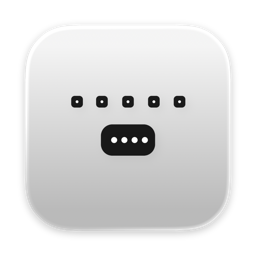
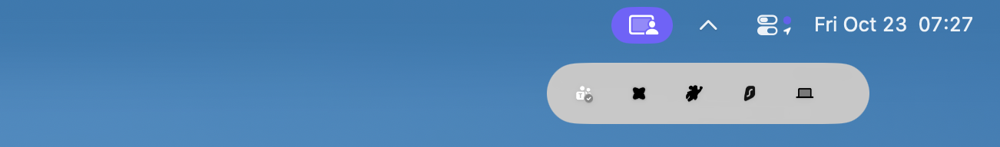

  
  <h1>OverflowBar</h1>
  
<strong>Give your menu bar a second row.</strong>

  
Move the menu bar icons you choose into a second row, then open their original menus and popovers from one place.

  
<a href="https://github.com/EvanProgramming/OverflowBar/releases/latest">Download for macOS</a> · <a href="#quick-start">Quick start</a> · <a href="#documentation">Documentation</a>

  
  
  
  

  

The second row keeps selected menu bar controls available while leaving their original menu-bar position clear.

**A clearer menu bar, without replacing your controls.** Choose which status icons to tuck away, open their real menus from the second row, and restore them whenever you like.

## Features

- **Choose icons individually.** Select the status items OverflowBar can arrange.
- **Hide new icons automatically.** Newly appearing eligible items join the saved selection while hiding is enabled.
- **Retry a layout.** Use the Settings toolbar to reveal the current arrangement and retry hiding without changing the saved selection.
- **Use the original controls.** Open source-app menus, popovers, and supported toggles.
- **See live previews.** Screen Recording enables captured previews; app icons remain available without it.
- **Use the keyboard and recover easily.** Navigate the panel, cancel an operation, reset the selection, or quit to reveal the icons.

## Installation

1. [Download the v1.5.1 DMG](https://github.com/EvanProgramming/OverflowBar/releases/download/v1.5.1/OverflowBar-1.5.1.dmg) or choose the [latest stable release](https://github.com/EvanProgramming/OverflowBar/releases/latest).
2. Drag OverflowBar into Applications, then open it. The current DMG is named OverflowBar-1.5.1.dmg.
3. Follow setup and select the icons you want in the second row.

If you prefer Homebrew, use the verified cask from this repository:

    brew tap EvanProgramming/overflowbar https://github.com/EvanProgramming/OverflowBar.git
    brew install --cask EvanProgramming/overflowbar/overflowbar

The community build is ad-hoc signed and is not notarized. If macOS blocks an app you downloaded from the official release, follow Apple's [Open Anyway instructions](https://support.apple.com/guide/mac-help/open-a-mac-app-from-an-unknown-developer-mh40616/mac).

OverflowBar targets macOS 15 and has a universal Apple silicon and Intel build. The v1.5.0 macOS 26.4 release check covered a limited native-fixture workflow; macOS 15 hardware and Intel hardware were not available for physical testing. On macOS 27 and later, native icon management fails open and leaves icons accessible. See [installation and compatibility](docs/INSTALLATION.md) and [release validation](docs/RELEASE_CHECKS_V1.5.1.md).

## Quick start

1. Enable **Accessibility** to arrange selected icons and open their controls.
2. Optionally enable **Screen Recording** for live icon previews.
3. In **Choose Icons**, select the status items to move.
4. Select **Hide Icons & Finish**.
5. Click **Open OverflowBar** in the menu bar, then choose an icon.

Turn off **Hide selected icons** to restore the selected icons. **Cancel** stops an active operation. **Reset Icon Selection** restores all icons and clears the selection; quitting reveals icons while keeping your saved choices.

## Documentation

- [Installation](docs/INSTALLATION.md) · [Using OverflowBar](docs/USAGE.md) · [Permissions](docs/PERMISSIONS.md)
- [Troubleshooting and FAQ](docs/TROUBLESHOOTING.md) · [Homebrew](docs/HOMEBREW.md) · [Privacy](PRIVACY.md)
- [Architecture](docs/ARCHITECTURE.md) · [Development](docs/DEVELOPMENT.md) · [Contributing](CONTRIBUTING.md)
- [Documentation index and release evidence](docs/README.md)

## Contributing and license

See the [contributing guide](CONTRIBUTING.md) for development setup and issue reports. Report security issues privately using [GitHub’s security reporting page](https://github.com/EvanProgramming/OverflowBar/security/advisories/new). OverflowBar is distributed under the [GPL-3.0 license](LICENSE); earlier code retains its [original MIT notice](LICENSE-MIT-ORIGINAL). Native-engine provenance is documented in [third-party notices](THIRD_PARTY_NOTICES.md).

The native engine incorporates portions of [Ice](https://github.com/jordanbaird/Ice) and [Thaw](https://github.com/thaw-app/Thaw); see the preserved [licenses and attribution](THIRD_PARTY_NOTICES.md).
