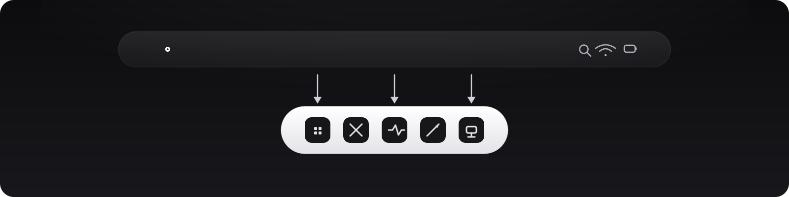
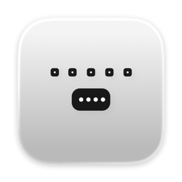
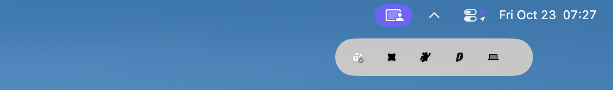
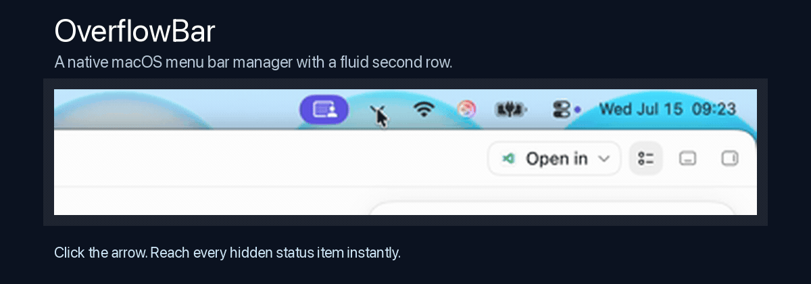
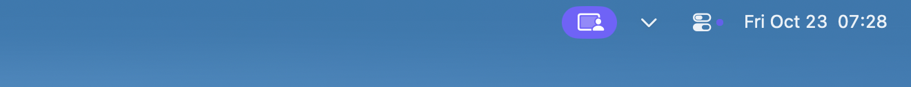

<p align="center">
  
</p>

<div align="center">
  
  <h1>OverflowBar</h1>
  <p><strong>A native macOS menu bar manager.</strong></p>
  <p>Give your menu bar a second row. Move the status icons you choose into a fluid second row, then open their real menus and popovers from one place — a clearer menu bar, without replacing your controls.</p>
  <p>
    <a href="https://overflowbar.top/">Official website</a> ·
    <a href="https://overflowbar.top/guides/mac-menu-bar-managers/">Menu bar manager comparison</a> ·
    <a href="https://github.com/EvanProgramming/OverflowBar/releases/latest">Download for macOS</a> ·
    <a href="#quick-start">Quick start</a> ·
    <a href="#documentation">Documentation</a>
  </p>
</div>

<p align="center">
  <a href="https://github.com/EvanProgramming/OverflowBar/releases/latest"></a>
  <a href="docs/INSTALLATION.md"></a>
  <a href="docs/INSTALLATION.md"></a>
  <a href="LICENSE"></a>
</p>

<p align="center">
  <a href="docs/assets/second-row-open.png"></a>
</p>

## What is OverflowBar?

OverflowBar is a **native macOS menu bar manager** built with SwiftUI, AppKit, and Liquid Glass. It tucks the status icons you select into a second row beneath the menu bar — keeping the original menu bar clear while every control stays one click away.

## Highlights

- **A second row, not a re-skin.** Your menu bar icons keep their original appearance and behavior; OverflowBar simply gives them a second home.
- **Real menus and popovers.** Every icon opens its actual menu or popover — never a re-implementation.
- **Safe and reversible.** Cancel, reset, or quit to bring every icon back to the menu bar.

## Features

| Arrange your menu bar | Stay in control |
| --- | --- |
| **Choose icons individually**<br/>Select the status items OverflowBar can arrange. | **Use the original controls**<br/>Open source-app menus, popovers, and supported toggles. |
| **Hide new icons automatically**<br/>Newly appearing eligible items join the saved selection while hiding is enabled. | **See live previews**<br/>Screen Recording enables captured previews; app icons remain available without it. |
| **Retry a layout**<br/>Use the Settings toolbar to reveal the current arrangement and retry hiding without changing the saved selection. | **Use the keyboard and recover easily**<br/>Navigate the panel, cancel an operation, reset the selection, or quit to reveal the icons. |

## See it in action

<p align="center">
  
</p>

<p align="center">
  
</p>

## Installation

<details open>
  <summary><strong>Direct download</strong></summary>

1. [Download the v1.5.1 DMG](https://github.com/EvanProgramming/OverflowBar/releases/download/v1.5.1/OverflowBar-1.5.1.dmg) or choose the [latest stable release](https://github.com/EvanProgramming/OverflowBar/releases/latest).
2. Drag OverflowBar into Applications, then open it. The current DMG is named `OverflowBar-1.5.1.dmg`.
3. Follow setup and select the icons you want in the second row.

</details>

<details>
  <summary><strong>Homebrew</strong></summary>

```bash
brew tap EvanProgramming/overflowbar https://github.com/EvanProgramming/OverflowBar.git
brew install --cask EvanProgramming/overflowbar/overflowbar
```

</details>

The community build is ad-hoc signed and is not notarized. If macOS blocks an app you downloaded from the official release, follow Apple's [Open Anyway instructions](https://support.apple.com/guide/mac-help/open-a-mac-app-from-an-unknown-developer-mh40616/mac).

OverflowBar targets macOS 15 and ships a universal Apple silicon and Intel build. The v1.5.0 macOS 26.4 release check covered a limited native-fixture workflow; macOS 15 hardware and Intel hardware were not available for physical testing. On macOS 27 and later, native icon management fails open and leaves icons accessible. See [installation and compatibility](docs/INSTALLATION.md) and [release validation](docs/RELEASE_CHECKS_V1.5.1.md).

## Quick start

1. Enable **Accessibility** to arrange selected icons and open their controls.
2. Optionally enable **Screen Recording** for live icon previews.
3. In **Choose Icons**, select the status items to move.
4. Select **Hide Icons & Finish**.
5. Click **Open OverflowBar** in the menu bar, then choose an icon.

Turn off **Hide selected icons** to restore the selected icons. **Cancel** stops an active operation. **Reset Icon Selection** restores all icons and clears the selection; quitting reveals icons while keeping your saved choices.

## Documentation

| Get started | Guides | Project |
| --- | --- | --- |
| [Installation](docs/INSTALLATION.md) | [Using OverflowBar](docs/USAGE.md) | [Architecture](docs/ARCHITECTURE.md) |
| [Permissions](docs/PERMISSIONS.md) | [Troubleshooting and FAQ](docs/TROUBLESHOOTING.md) | [Development](docs/DEVELOPMENT.md) |
| [Homebrew](docs/HOMEBREW.md) | [Privacy](PRIVACY.md) | [Contributing](CONTRIBUTING.md) |

- [Documentation index and release evidence](docs/README.md)

## FAQ

<details>
  <summary>Does OverflowBar need Screen Recording to hide icons?</summary>

No. Accessibility enables native arrangement and activation; Screen Recording only adds live previews.

</details>

<details>
  <summary>Does OverflowBar upload my icon previews?</summary>

No. Preview captures and layout selections stay local. See [Privacy](PRIVACY.md).

</details>

<details>
  <summary>How do I restore every icon?</summary>

In Settings, choose **More → Reset Icon Selection**. Quitting also reveals the icons without clearing your saved selection.

</details>

<details>
  <summary>How do I uninstall?</summary>

Quit OverflowBar, then remove it from Applications. Quitting reveals the icons. See [Installation](docs/INSTALLATION.md#uninstall).

</details>

## Contributing

See the [contributing guide](CONTRIBUTING.md) for development setup and issue reports. Report security issues privately using [GitHub's security reporting page](https://github.com/EvanProgramming/OverflowBar/security/advisories/new).

## License

OverflowBar is distributed under the [GPL-3.0 license](LICENSE); earlier code retains its [original MIT notice](LICENSE-MIT-ORIGINAL). Native-engine provenance is documented in [third-party notices](THIRD_PARTY_NOTICES.md).

The native engine incorporates portions of [Ice](https://github.com/jordanbaird/Ice) and [Thaw](https://github.com/thaw-app/Thaw); see the preserved [licenses and attribution](THIRD_PARTY_NOTICES.md).
