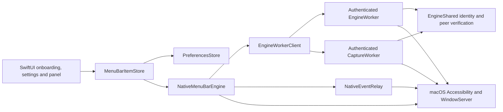

# Architecture

OverflowBar keeps SwiftUI presentation, native state, and macOS services in separate layers. The app owns preferences and visible state; serialized native-engine work resolves and operates the real status items.

## Identity and discovery

A selected item's persistent identity uses its originating application bundle and Accessibility identifier or name. Window IDs and process IDs are temporary handles, refreshed before native operations. On macOS 26, Control Center hosts many status-item windows; discovery attributes their source using the originating app's Accessibility extras, exact backing-window matches, and unique same-row geometric matches. Ambiguous items remain visible.

## Helpers and capture

The app runs authenticated discovery and capture XPC helpers. Discovery performs bounded status-item resolution and Accessibility activation. Capture performs ScreenCaptureKit and private SkyLight capture. Separate connections allow the capture helper to be recycled without interrupting layout work.

Each service checks the calling app's designated code-signing requirement before accepting a request. Requests and image payloads are bounded. Screen captures stay in memory. The capture worker has a bounded retry path; there is no unauthenticated fallback.

## Layout and activation

The engine serializes discovery, layout application, activation, cancellation, and recovery. It plans placement against a current native snapshot, fixes the divider, and applies a shared deadline. Each move checks fresh endpoints and settled placement. Cancellation and failure release input state; only verified placement is persisted.

Activation resolves its source again, delivers a supported Accessibility press or scoped native event, and verifies an observable menu, popover, or status-item change. If the result is uncertain, the item stays accessible. Restoration uses saved neighbor identities only after the engine observes the native interface close.

## Lifecycle and limits

Preferences store selected item identities and the desired hidden state. The app distinguishes requested layout from realized macOS visibility. Quitting reveals the originals without deleting saved choices. The capture panel refreshes only while visible. Permission denial is shown explicitly.

On macOS 27 and later, the engine fails open and disables native menu-bar management. Release source and deployment metadata do not establish runtime compatibility; use the [release acceptance report](RELEASE_CHECKS_V1.5.md) and [physical validation checklist](NATIVE_VALIDATION.md) for evidence and limits.

## Related guides

[Development](DEVELOPMENT.md) · [Permissions](PERMISSIONS.md) · [Native validation](NATIVE_VALIDATION.md) · [Third-party notices](../THIRD_PARTY_NOTICES.md)
